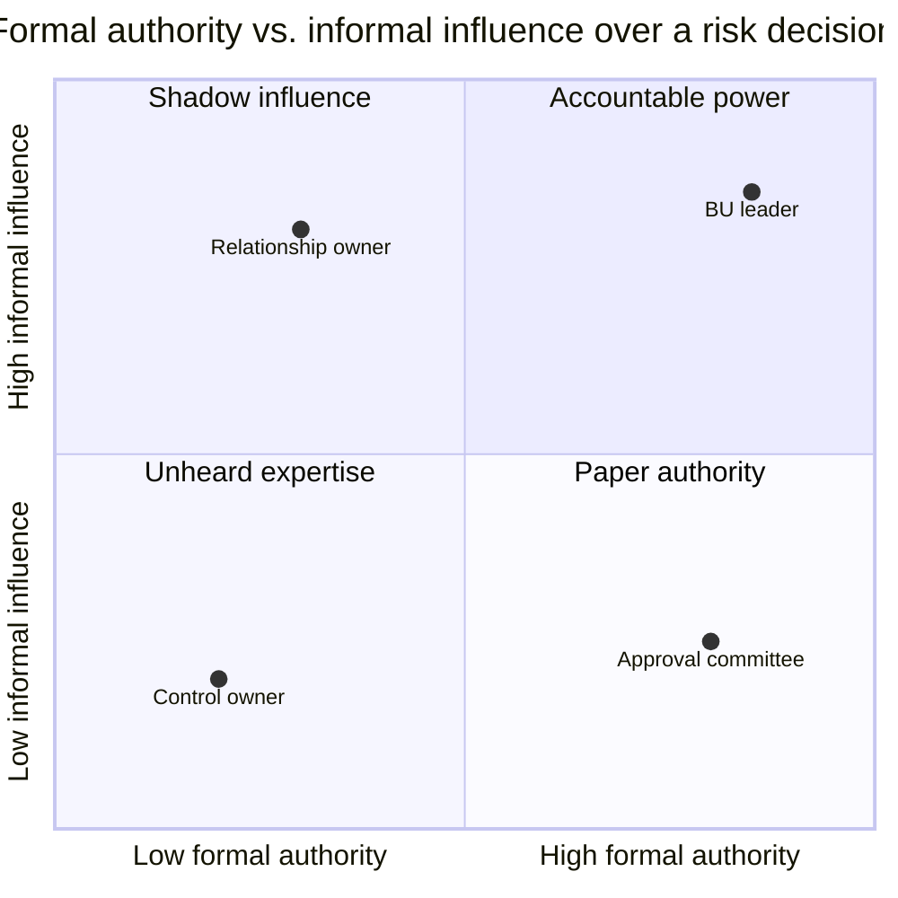
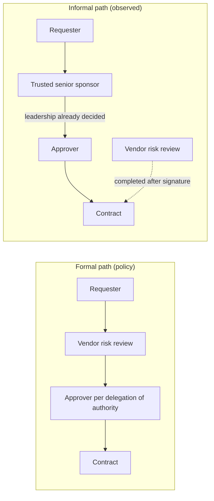

# Formal Authority vs. Informal Influence

The org chart shows who is *supposed* to decide. The influence map shows who *actually* shapes the decision. Risk hides in the gap.

## Two dimensions

*Points are illustrative role examples, not measurements.*

| Quadrant | Who often sits here (illustrative) | Risk it can create | What the analyst checks |
|---|---|---|---|
| **Accountable power** (high formal, high informal) | Business unit leader who owns the budget and the room | Self-approval; risk appetite set by preference; dissent suppressed | Independent second approver; minutes show challenge |
| **Shadow influence** (low formal, high informal) | Long-tenured relationship owner, executive assistant, "go-to" fixer, sponsor's trusted adviser | Decisions steered with no record or accountability; gatekeeping of vendor information | Who people go to first; whether formal approvers wait on this person |
| **Paper authority** (high formal, low informal) | Committee that approves whatever arrives; approver many levels removed from the work | Rubber-stamp approvals; control exists only on paper | Approval speed, return rate, whether approver can explain the basis |
| **Unheard expertise** (low formal, low informal) | Engineers, control owners, junior analysts, the person who runs the vendor portal | Early warnings never reach decision-makers | Interruptions; concerns raised once then dropped; off-record comments |

## How a decision actually flows (illustrative)

## How to build an influence map without being intrusive

1. Start from the formal RACI or delegation-of-authority matrix.
2. In interviews, ask: "When you need this approved quickly, who do you talk to first?" and "Whose opinion do approvers wait for?"
3. Check approval trails and email routing (within your authorized access) for steps that are not in the formal path.
4. Mark where the formal and observed paths differ. Each difference is a question, not an accusation.
5. Keep the map role-based (for example "relationship owner" or "sponsor"), not a list of names, when it is shared beyond the review team.
