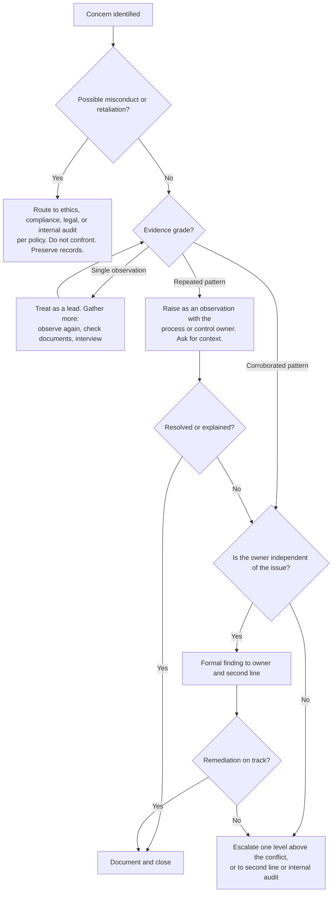

# Escalation Decision Guide: Raising Power-Related Findings Safely and Factually

Power-related findings are sensitive because the person creating the risk may be senior to you, or senior to the person you report to. The goal is to get the issue to someone **independent enough to act**, with **evidence strong enough to stand**, in a way that **protects people**.

## Step 1. Classify what you have

| Type | Examples | Default route |
|---|---|---|
| **Process or design gap** | Missing workflow gate; unclear acceptance authority; minutes don't record dissent | Process owner, then your manager or the risk function |
| **Control not operating** | Due diligence after contract; repeated exceptions; re-dated findings | Control owner and second line (risk, compliance, security) |
| **Governance concern** | Oversight forum not challenging; acceptance above the approver's authority | Second-line leadership (for example CRO, CISO); consider internal audit |
| **Possible misconduct** | Undisclosed conflict of interest; falsified records; deliberate override for personal gain | **Do not investigate yourself.** Ethics/compliance, legal, or internal audit per policy |
| **Possible retaliation** | People sidelined after raising concerns | Ethics/HR/legal channel per policy; protect the source |

## Step 2. Check your evidence

## Step 3. Raise it well

- **Lead with the process and its effect on risk**, not the person: "Risk acceptances above threshold are being approved without the independent review the policy requires."
- **Bring the evidence**, organized by source, with the grade stated.
- **Invite context**: "Is there an approval or circumstance we haven't seen?" Legitimate management intervention exists; give room for it.
- **Propose a proportionate fix** so the conversation is about solving, not blaming.
- **Put it in writing** after any verbal discussion, with facts only.

## Step 4. Protect people (including yourself)

- Never attribute interview comments without consent; report themes in aggregate.
- Keep notes factual, dated, and stored per records policy.
- Know your organization's non-retaliation policy and speak-up channels before you need them.
- If you are pressured to soften or drop a finding, document the request factually and raise it with your own manager, second-line leadership, or internal audit (the IIA Three Lines Model's third line exists for exactly this kind of independence).
- If you feel unsafe raising something internally, use the organization's separate communication lines (COSO 2013 Principle 14 point of focus) or seek legal advice on external options.

## Step 5. Know when *not* to escalate yet

- One meeting, one comment, one gesture: gather more evidence first.
- A plausible legitimate explanation you haven't checked.
- A personality clash with no effect on risk. That is a management matter, not a risk finding.

## Red lines (always escalate, even with limited evidence, through the proper channel)
- Indications of falsified records or documents
- Undisclosed financial or personal interest in a supplier decision
- Pressure on you or others to alter findings or evidence
- Signs that someone is being punished for raising a concern
